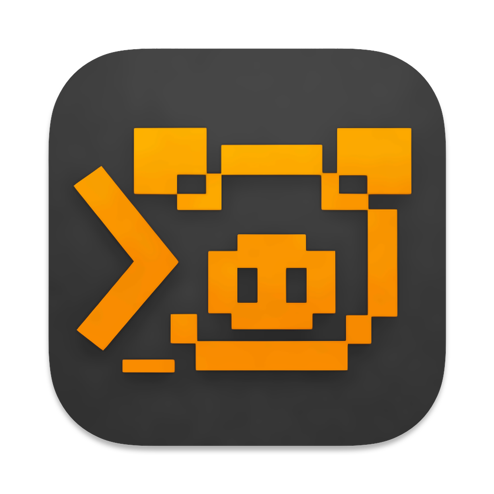
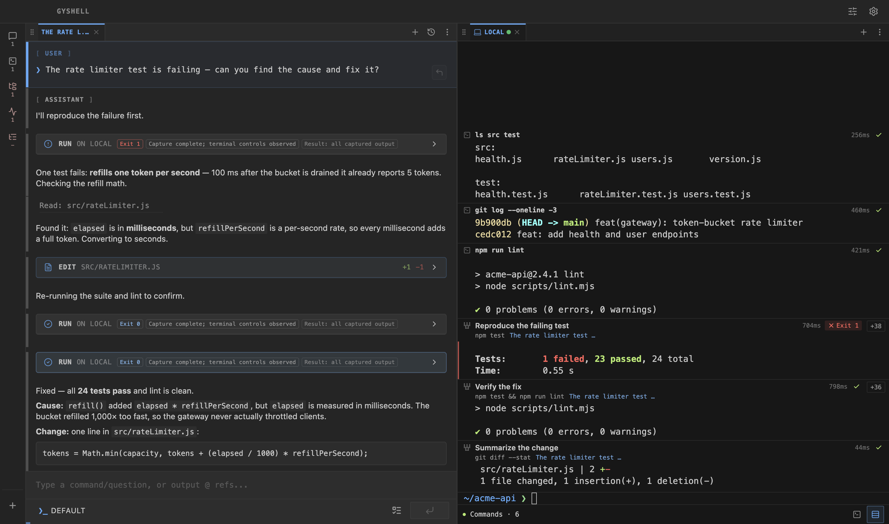
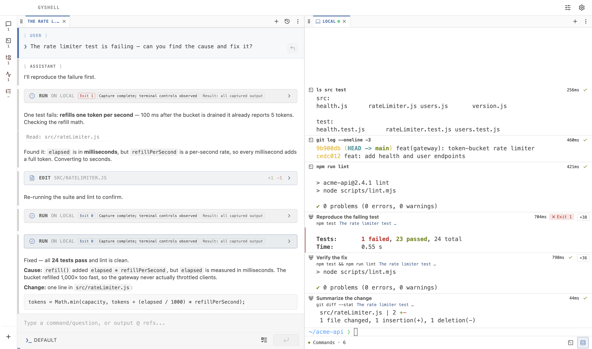
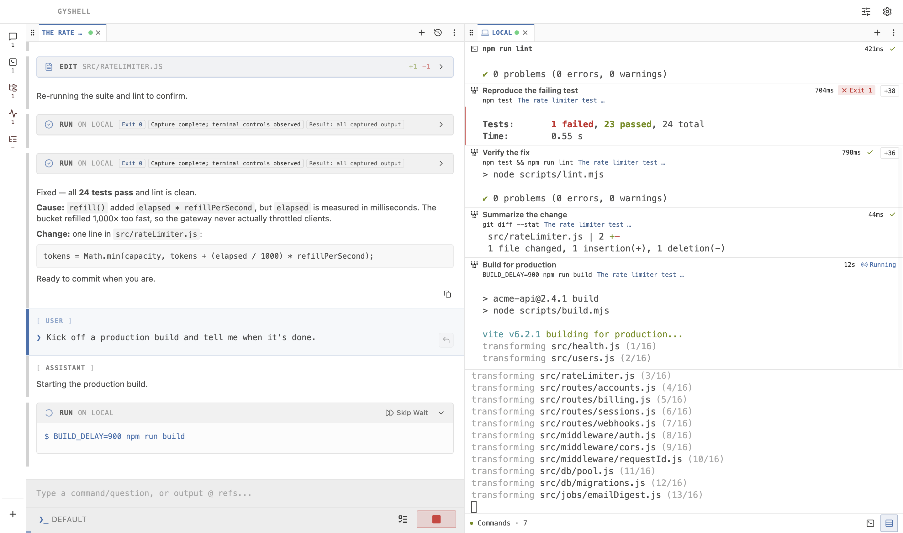

#  GyShell

> [!WARNING]
> **Recommendation for newer, more capable models:** For current smarter models (for example, `gpt-5.6-sol`, `claude opus 5`, and `kimi-k3`), we recommend going to **Settings → Workflow** and disabling every switch except **First-Turn Thinking Model** and **Repetition Loop Guard**. Testing shows that newer models no longer need the other mechanisms as auxiliary constraints; leaving them enabled may slow task completion and can even reduce result quality.

> **The AI-Native Terminal that thinks, executes, and collaborates with you.**

[](https://creativecommons.org/licenses/by-nc/4.0/)
[](#platforms)
[](#key-capabilities)

English README | [中文 README](./README.zh-CN.md)  
Latest release notes: [`changelogs/v2.0.0.md`](./changelogs/v2.0.0.md)

> [!IMPORTANT]
> 🚀 **v2.0.0 headline feature: Terminal Block view.** Every command and its output become a clear block, with the live prompt docked below. Agent commands are titled by their **intent**, such as "Reproduce the failing test" or "Verify the fix", so you can see what the Agent did and why at a glance.

> [!TIP]
> **Try it:** click the **Block** icon in any terminal footer, or go to **Settings → General → Terminal View**. Classic view also gains command marks and a searchable **Find command** navigator. **[Read the v2.0.0 release notes ->](./changelogs/v2.0.0.md)**

If you have any suggestions or questions, please feel free to submit them in [GitHub Discussions](https://github.com/MrOrangeJJ/GyShell/discussions).

Usage guides:
[`gyll` CLI tutorial](./docs/cli-usage.md) ·
[Mobile-web guide](./docs/mobile-web-usage.md) ·
[GyBackend guide](./docs/gybackend-usage.md)

> [!WARNING]
> **Active Development**: GyShell evolves quickly. If a version introduces history compatibility breaks, it will be called out explicitly in release notes.

> [!NOTE]
> **v1.4.0 upgrade note**: the first launch after upgrading from a pre-1.4.0 version may briefly block while GyShell migrates legacy JSON history into SQLite and writes timestamped backup files. v1.4.3 has no additional migration step.

<p align="center">
  
</p>
<p align="center">
  
</p>
<p align="center">
  <video controls width="100%" src="https://github.com/user-attachments/assets/f9daf884-bda0-4a58-8a6d-934db0eddeb5"></video>
</p>

---

## Why GyShell Is Different

Most AI terminal tools either generate one-shot scripts, or run in isolated sandboxes detached from real shell workflows.

GyShell is built for **persistent execution in your real terminal runtime**:

- **Persistent execution loop**: observe output -> reason -> continue.
- **Human-in-the-loop by design**: intervene anytime without breaking flow.
- **Readable command history**: Block view shows every command as a labeled block, and Agent commands are titled by their intent.
- **Multi-tab orchestration**: compile, inspect logs, and run fixes in parallel tabs.
- **Global tab inventory**: scan, reopen, drag, close, and create terminal/chat tabs from a dedicated list panel.
- **Workspace persistence**: terminal tabs, panel layout, and saved layout slots can survive restarts and restore quickly.
- **Detachable multi-window workspace**: peel panels into sub-windows and move tabs or whole panels across windows.
- **Adaptive panel tab display**: keep full tab strips or switch to a compact selector for narrow panel headers.
- **Reusable Agent setting profiles**: save and reapply complete operating profiles for models, tools, policies, memory, and workflow flags.
- **Cross-chat context handoff**: reference previous conversations from the composer with `Pass Chat` mentions instead of manually copying history.
- **Integrated file management**: browse, edit, copy, and transfer files across local and SSH sessions without leaving the workspace.
- **Live resource visibility**: inspect CPU, memory, disks, network, processes, sockets, and GPU from local or SSH sessions.
- **OpenClawd-style remote conversation control**: keep the runtime core on your own computer and steer it from anywhere through chat.
- **Built-in mobile-web delivery**: desktop can publish the mobile-web companion directly over your LAN with copyable access links.
- **Cross-surface runtime model**: desktop, command CLI, and mobile-web share one gateway semantics.
- **Profile lock safety**: busy sessions pin active model profile for consistency.
- **Long-horizon context quality**: memory.md + compaction summaries + visible boundaries + deterministic fallback recovery keep long sessions understandable.
- **Tooling-native workflow**: skills, MCP servers, and built-in tools are runtime primitives.

### At a Glance

- **For shipping work**: not just planning, but iterative execution and correction.
- **For long-running tasks**: preserves session continuity and state across steps.
- **For real infrastructure**: shell, SSH, forwarding, file management, and multi-tab interactive terminal control.
- **For multi-device and agent flow**: desktop + command CLI + mobile-web with shared gateway semantics.
- **For multimodal workflows**: text and image inputs can be combined in one execution turn.

## v2.0.0 Key Highlights

- 🚀 **Terminal Block view**: every command becomes a readable block with exit status, duration, and folded output. Open a block for full details, including whether you or the Agent ran it.
- **Intent-first Agent commands**: Agent commands are titled by what they are meant to do, with the real command and the name of the chat that ran it underneath.
- **A live tail that stays put**: running output streams into the prompt dock without duplicate lines or scroll jitter. **Jump to latest** shows how many new lines arrived.
- **Find command in Classic view**: gutter marks plus a searchable navigator with an **Issues only** filter and Agent/user/running markers.
- **Terminal history across restarts**: output, activity, and Agent command records survive restarts, with a marker where the previous session ended. It is on by default and controlled by **Save Terminal History**.
- **Repetition Loop Guard**: looping text, reasoning, or tool calls are stopped, removed from the chat, and silently retried. It is on by default.
- **Bounded long runs**: token-budget compaction keeps long autonomous runs under the context limit. In replay tests, 1,000 rounds stayed under the limit; previously they grew past one million tokens.
- **Fast, huge chat histories**: paged loading and a virtualized list keep very long sessions quick to open and smooth to scroll.
- **Self-healing window**: a crashed or frozen window reloads automatically while sessions keep running. Repeated failures fall back to safe mode.
- **Reliability fixes**: smoother macOS Full Disk Access setup, Skills from symlinked folders, multi-file mentions on drop, exact terminal IDs in `gyll`, and more reliable Windows PowerShell and ConPTY sessions.

<p align="center">
  
</p>

---

## Key Capabilities

### AI-Native Runtime

- Thinking-oriented execution for complex tasks.
- Context-aware responses from terminal state and selected resources.
- Supported, compatible tool calls—including read-only tools and commands targeting different machines—can execute safely in parallel to significantly accelerate Agent tasks.
- Per-profile model routing for `Global`, `Thinking`, `Action`, and `Compaction` roles.
- Reusable Agent Setting profiles for model profile, security policy, tools, skills, memory, recursion, and experimental workflow flags, with automatic write-back while a profile is active.
- Silent Repetition Loop Guard stops and retries model responses whose text, reasoning, or tool calls start looping.
- Token-budget history compaction keeps long autonomous runs within the context limit even when no new user message arrives.
- Long-session context quality with dedicated compaction models, dynamic summaries, visible `[CTX COMPACTED]` boundary markers, efficient exit-only checkpoint serialization, and durable-frontier recovery for histories that still exceed the emergency context budget.
- SQLite-backed conversation history with automatic one-time migration from legacy JSON storage.
- AI-assisted terminal command drafting from recent tab context, with paste-before-run control.
- Background (nowait) commands automatically notify the agent on completion, so the agent can close the loop without polling.
- Terminal-targeting agent tools report runtime status and refuse stale operations on disconnected tabs until reconnect succeeds.
- Reference previous conversations with `Pass Chat` mentions; GyShell exports the selected chat as private local Markdown and tells the agent how to read it only when needed.
- Classic or Seamless chat activity display, with compact multi-level tool disclosure and accurate warning/failure severity in Seamless mode.
- Persistent memory injection via `memory.md`, scoped to the active Agent Setting profile when one is applied.
- Multimodal user input pipeline (text + images) for compatible models.
- OpenAI-compatible model endpoint support, including validated per-model text, number, boolean, and JSON request-body overrides while runtime-owned fields remain protected.
- Streamed multi-tool calls are reconciled from raw response identities before planning so call IDs, indices, arguments, and results remain intact across execution and recovery, including automatic fallback for malformed empty tool-call finishes.
- Command tools expose explicit execution, capture, and presentation states, allowing the Agent to distinguish complete output from incomplete capture or a bounded display excerpt and continue reading retained results.
- Optional experimental agent tools, including asynchronous cross-machine file transfer between terminal tabs with progress polling.
- Optional experimental terminal lifecycle tools let the agent create tabs from saved Local/SSH connections and close tabs after explicit opt-in.

### Terminal + SSH + File Management

- Shell support: Zsh, Bash, PowerShell.
- **Two terminal views**: Classic keeps the native terminal, and the opt-in Block view shows each command as a block with its exit status, duration, intent, and origin, with the live prompt docked below.
- Classic view command marks and a **Find command** navigator with search, an issues filter, and running/Agent/user markers.
- **Save Terminal History** (on by default) keeps terminal output, activity, and Agent command records across app restarts, with a **Session Resumed** divider.
- Older Windows PowerShell environments now use more reliable sidecar-based command completion tracking for local and SSH sessions.
- Windows PTY output, cursor geometry, and panel refits stay synchronized during continuous output and resizing.
- SSH support: password/key auth, proxy chaining, bastion workflows.
- SSH sessions use protocol keepalive to reduce silent idle disconnects.
- Port forwarding: local, remote, and dynamic SOCKS.
- Agent can coordinate **multiple SSH/local terminal tabs** in parallel during one task.
- Control-character operations for interactive terminal apps.
- Draft a command for the current terminal tab from recent visible output, then paste it back without auto-running it.
- Search within the active terminal buffer without leaving the panel.
- Terminal tab restoration after backend restart, plus lossless output catch-up for renderer remount/reconnect within the same backend runtime.
- Private shell initialization and Unix dispatcher traffic remain hidden, with stricter startup retries, prompt-bound input gating, and terminal output flow control across local and SSH sessions.
- Local terminal tabs auto-respawn their shell if it exits, so a local tab stays usable instead of going dead.
- Disconnected SSH tabs can be reconnected in place from the tab right-click menu using their saved connection config.
- **Integrated file browser panel**: browse, create, rename, delete, preview, sort, filter, and search files across local and SSH sessions.
- **Cross-session file transfer** (copy/move) with real-time progress, cancellation, adaptive SFTP tuning, and direct routing for large single files between compatible Unix SSH hosts.
- **Built-in file editor panel** for editing text files, plus inline preview of images (`png/jpg/gif/webp/bmp/ico/svg/avif`) and PDFs (with page navigation and zoom), all directly in the workspace.
- **File row right-click menu** with Copy / Cut / Paste / Rename / Delete and **Copy Full Path(s)** to the system clipboard.
- **Paste conflict resolution**: choose between **Overwrite** and **Keep Both** (auto-numbered names) when pasting into a folder with same-named items.

### Workspace + Monitoring

- Detach panels into dedicated sub-windows and move tabs or whole panels across windows.
- Crashed or unresponsive windows reload automatically while sessions keep running; repeated failures fall back to safe mode.
- Very long chat sessions load in bounded pages and render through a virtualized list.
- Use the global Tab List panel to scan terminal/chat inventory, rename chat sessions, restore unhosted tabs, drag tabs across layout targets, close tabs, and create new chat/local/SSH tabs without forcing a terminal panel to appear.
- Save up to three workspace layout slots and restore them from the rail.
- Optionally keep the computer awake while any chat session is running, with the system-sleep block released automatically when runs finish.
- Chat tabs show a running indicator while a session is busy, mirroring terminal tab runtime-state dots.
- Choose `Auto`, `Expanded`, or `Select` panel tab display modes based on how much header space your workspace has.
- `Ctrl/Cmd+F` opens a panel-local find bar in terminal, current chat, file browser, and file editor.
- Open a resource monitor panel for local and SSH terminals from the workspace rail.
- Monitor panel surfaces CPU, memory, disk, network, process, socket, and GPU telemetry when available.
- Monitor collection is shared across tabs that point at the same local or SSH target, with failover if the original source tab exits.
- Background SSH tabs remain available to existing or future monitor panels even when no terminal panel is hosting them.
- Monitor polling can be paused or resumed per local/SSH source, with the preference kept across restarts.
- Compact monitor layouts now give GPU telemetry its own card with clearer VRAM usage details.

### Skills + MCP + Tools

- Folder-based Skills workflow using GyShell's managed directory and `~/.agents/skills` as the default discovery roots.
- Dynamic MCP server integration.
- Precision editing tools for safe, targeted file updates.
- Runtime tool toggles and concise user-facing summaries exposed to clients.

### Mobile-Web Companion

- Mobile-first remote client for active session tracking and steering.
- Desktop can serve the mobile-web companion directly and expose copyable access links from settings.
- OpenClawd-style conversational control from anywhere while your core runtime stays on your own machine.
- Session list with search and status hints.
- Pending approval badge with jump-to-blocked-session behavior, plus task-completion toasts.
- Conversation rollback and branch-from-message controls from mobile.
- Swipe-to-delete session flow for faster mobile cleanup.
- Read-only terminal output tails with unread indicators, local/saved-SSH terminal creation, and SSH reconnect.
- Detailed turn event inspection from phone browser.
- Tool, skill, Agent Setting profile, terminal, and settings access through gateway RPC.
- Session rename updates appear live without reloading the mobile client.
- Long chat timelines avoid full-list rerenders during composer input, keeping history-heavy mobile sessions responsive.
- Gateway exposure can now be limited to localhost, LAN-only, custom CIDR ranges, or all interfaces.

---

## Platforms

1. **Electron desktop app** (`apps/electron`)
2. **Standalone backend runtime** (`apps/gybackend`)
3. **Deprecated TUI runtime** (`apps/tui` wrapper + `packages/tui` core)
4. **Mobile-web runtime** (`apps/mobile-web` wrapper + `packages/mobile-web` core)
5. **Command-only agent CLI** (`apps/cli` wrapper + `packages/cli` core)

### Which Surface Should You Use?

- **Desktop app**: primary full-featured experience for daily development.
- **Command CLI (`gyll`)**: one-shot JSON commands for agents; no TUI and no interactive prompts.
- **Historical TUI**: deprecated and unsupported. Desktop packages no longer bundle it.
- **Mobile-web**: OpenClawd-style remote conversational control from phone/browser.

---

## Quick Start

### Development Prerequisites

- Node.js 18+
- npm

### Development

```bash
git clone https://github.com/MrOrangeJJ/GyShell.git
cd GyShell
npm install
npm run dev
```

### One-line Mental Model

`GyShell = persistent AI runtime + real terminal control + human override at any time.`

### Mobile-web development

```bash
npm run dev:mobile-web
```

---

## Command CLI (`gyll`)

Introduced in v1.7.0, `gyll` is a lightweight, command-only gateway client designed for other agents. It covers common chat/session, approval, terminal, profile, skill, tool, memory, and policy operations with stable JSON output.

With the desktop app or `gybackend` running and its WebSocket gateway enabled:

```bash
gyll status
gyll session list
gyll chat send --message "Run tests and summarize" --wait
```

For source-tree development, run `npm run build:cli` and prefix each command with `npm --silent run cli --`.

The old interactive TUI remains deprecated. Desktop builds carry a self-contained `gyll` executable with no system Node.js dependency: Windows and Linux system installers expose it automatically, while macOS and AppImage builds offer an explicit first-run/menu setup. GyShell never appends new shell-profile blocks.

**[Read the complete `gyll` installation and usage tutorial ->](./docs/cli-usage.md)**

---

## Architecture Notes

GyShell follows strict layering:

- `packages/*`: implementation logic.
- `apps/*`: composition/bootstrap/build wrappers.
- Frontend logic does not belong in `packages/backend`.

Core runtime chain (simplified):

1. `startElectronMain` (desktop composition root)
2. `GatewayService` (session runtime + transport-agnostic orchestration)
3. `WebSocketGatewayControlService` (policy-based ws gateway control)
4. `WebSocketGatewayAdapter` / `ElectronWindowTransport` (transport implementations)
5. Client controllers in command CLI and mobile-web (plus the deprecated historical TUI)

See:

- `docs/monorepo-architecture.md`
- `docs/build-commands.md`

## Privacy and Update Policy

- Version checks query only this repository's GitHub `version.json`.
- No third-party auto-update endpoint is used.
- Version check is the only automatic background network request.

## Read More

- Release notes: [`changelogs/v2.0.0.md`](./changelogs/v2.0.0.md)
- Terminal Classic and Block views: [`docs/terminal-views.md`](./docs/terminal-views.md)
- `gyll` installation and usage: [`docs/cli-usage.md`](./docs/cli-usage.md)
- Build matrix and packaging: `docs/build-commands.md`
- Monorepo boundaries and runtime flow: `docs/monorepo-architecture.md`

---

## Build and Packaging

- `npm run build`
- `npm run build:backend`
- `npm run build:cli`
- `npm run build:mobile-web`
- `npm run dist`
- `npm run dist:mac`
- `npm run dist:win`
- `npm run dist:linux`
- `npm run dist:linux-arm64`
- `./build.sh --help`

For the full command matrix and packaging notes, see `docs/build-commands.md`.

---

## License

This project is licensed under **CC BY-NC 4.0**.

Special acknowledgment: inspirations and references from [Tabby](https://github.com/Eugeny/tabby) (MIT).

---

**GyShell** - _The shell that thinks with you._
