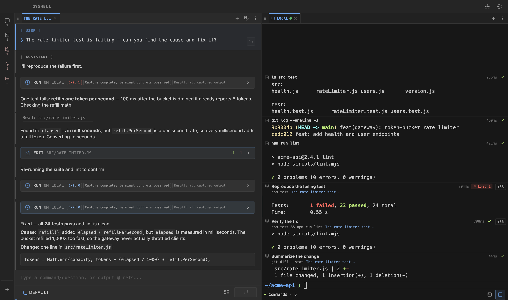
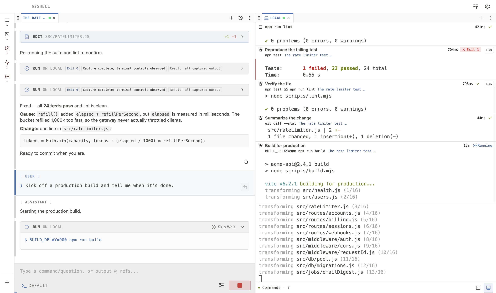
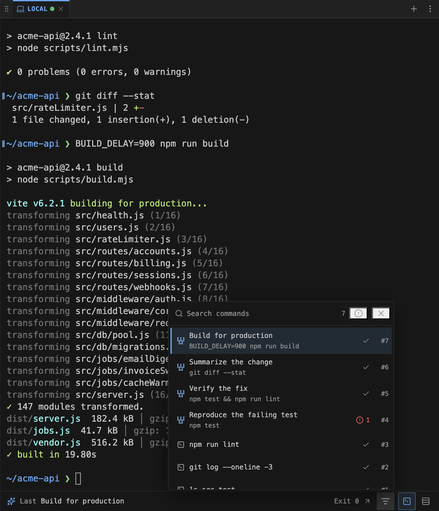
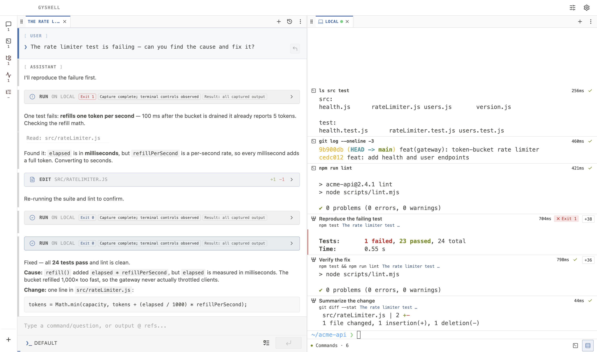

# v2.0.0 Release Notes

> [!WARNING]
> **Recommendation for newer, more capable models / 面向新一代高智能模型的建议：**
> For current smarter models (for example, `gpt-6.1-sol`, `claude opus 5-5`, and `glm-5.3`), we recommend going to **Settings → Workflow** and disabling every switch except **First-Turn Thinking Model** and the new **Repetition Loop Guard**. Testing shows that newer models no longer need the other mechanisms as auxiliary constraints; leaving them enabled may slow task completion and can even reduce result quality.
>
> 对于当前更聪明的模型（例如 `gpt-6.1-sol`、`claude opus 5-5`、`glm-5.3`），建议在 **设置 → 机制** 中关闭除 **首轮使用思考模型** 和新增的 **重复循环守卫** 之外的所有开关。经实测，新模型的智力已经不再需要其他机制辅助约束；保持开启可能会拖慢模型完成任务的速度，甚至导致完成效果更差。

## English

v2.0.0 changes how you read your terminal. The new **Block view** turns every command into a clear, labeled block. You can see what you ran, what the Agent ran, and why. Long autonomous runs and very large chats also stay fast and within budget.

> [!IMPORTANT]
> 🚀 **Headline feature: Terminal Block view.** Each command and its output now appear as a block, with the live prompt docked below. Agent commands are titled by their **intent**, such as "Reproduce the failing test" or "Verify the fix", instead of raw shell text. Exit status, duration, and the name of the chat that ran the command sit beside each block.

> [!TIP]
> **Try it:** click the **Block** icon in any terminal footer, or go to **Settings → General → Terminal View**. Block view is opt-in, and GyShell remembers your choice across restarts. Switch back to **Classic** at any time.

  

### What You Will Notice

- 🚀 **Terminal Block view** — Every command becomes a readable block with its exit status, duration, and output. Failed commands stand out, and long output folds to its last lines. Open any block for full details: command, start and end time, duration, session, and whether you or the Agent ran it.
- **See why the Agent ran each command** — Agent commands are titled by their intent, with the real command and the name of the chat that ran it underneath. You can follow an Agent run at a glance without reading every line.
- **A live tail that stays put** — While a command runs, the newest output streams into the prompt dock below its block. The dock does not repeat lines or jump when you scroll. Scroll up freely, and use **Jump to latest** to return, with a count of new lines that arrived while you were away.
- **Find any command in Classic view** — Classic view gains gutter marks at each prompt and a **Find command** navigator. Search past commands, filter to **Issues only**, and jump straight to any command. Running, Agent, and user commands are each marked.
- **Terminal history survives restarts** — Terminal output, activity, and Agent command records are now kept across app restarts, and a **Session Resumed** divider shows where the previous session ended. This is on by default; turn off **Save Terminal History** to stop saving and delete what was saved.
- **Repetition Loop Guard** — If a model starts repeating its text, its reasoning, or the same tool call, GyShell stops the response, removes it from the chat, and quietly retries. It is on by default under **Settings → Workflow**.
- **Long autonomous runs stay within the context limit** — History compaction now works from a token budget, so a long run keeps compacting even when you send no new message. In replay tests, 1,000 autonomous rounds stayed under the limit; previously they grew past one million tokens.
- **Huge chat histories open fast and scroll smoothly** — Very long sessions load in bounded pages and render through a virtualized list. List order also stays stable when you switch sessions.
- **Self-healing window** — If the window crashes or stops responding, GyShell reloads it automatically while your sessions keep running in the background. Repeated failures fall back to a safe mode instead of a blank screen.
- **Smoother macOS setup** — On first launch, GyShell offers optional guidance for granting Full Disk Access, so protected-folder prompts do not interrupt unattended Agent tasks. Local terminals also start reliably in packaged builds.
- **Refreshed Agent system prompt** — The Agent runs on an updated system prompt (U17).
- **More reliable everyday details** — Skills load from symlinked folders. Dropping several files keeps every file mention. Images from `read_file` are no longer attached twice. Branching a chat works after history recovery. `gyll` and the bridges keep exact terminal IDs. Windows PowerShell and ConPTY sessions start and redraw more reliably.

### Block View in Action

  

  

---

## 中文

v2.0.0 改变了你阅读终端的方式。全新的 **块视图（Block）** 把每条命令整理成清晰、带标题的命令块：你运行了什么、Agent 运行了什么、为什么运行，一眼就能看懂。同时，长时间自主运行与超长聊天也更快、更不容易超出上下文预算。

> [!IMPORTANT]
> 🚀 **本次核心更新：终端块视图。** 每条命令及其输出都会成为一个独立的命令块，实时提示符停靠在下方。Agent 执行的命令以 **意图** 作为标题（例如 "Reproduce the failing test"、"Verify the fix"），而不是一串原始 shell 文本；退出状态、耗时以及发起该命令的聊天名称都显示在命令块旁边。

> [!TIP]
> **马上体验：** 点击任意终端底栏的 **块** 图标，或前往 **设置 → 通用 → 终端视图**。块视图为可选功能，GyShell 会在重启后记住你的选择，随时可以切回 **经典** 视图。

  

### 你会直接感知到的更新

- 🚀 **终端块视图** — 每条命令都会成为易读的命令块，附带退出状态、耗时与输出；失败命令一眼可见，长输出会折叠为最后几行。打开任意命令块即可查看完整详情：命令、开始与结束时间、耗时、所属会话，以及由你还是 Agent 执行。
- **看懂 Agent 为什么运行每条命令** — Agent 命令以意图作为标题，下方显示真实命令以及发起它的聊天名称。无需逐行阅读，就能快速跟上 Agent 的执行过程。
- **稳定不跳动的实时输出** — 命令运行时，最新输出会实时流入命令块下方的提示符停靠区；停靠区不会重复显示内容，滚动时也不会跳动。你可以自由向上翻看，再点击 **跳到最新** 回到底部，期间新增了多少行也会一并提示。
- **经典视图也能快速定位命令** — 经典视图在每个提示符旁新增命令标记，并提供 **定位命令** 面板：搜索历史命令、勾选 **只看异常**、一键跳转到任意命令；运行中、Agent 和用户命令都有各自的标识。
- **终端历史跨重启保留** — 应用重启后会保留终端输出、活动信息和 Agent 命令记录，并用 **会话已恢复** 分隔线标出上次会话的结束位置。该功能默认开启；关闭 **保存终端历史** 会停止保存并删除已保存的终端历史。
- **重复循环守卫** — 当模型开始重复输出文本、推理内容或同一个工具调用时，GyShell 会立即中止本次回复、将其从聊天中移除并静默重试。该功能默认开启，位于 **设置 → 机制**。
- **长时间自主运行不再超出上下文** — 历史压缩改为按 token 预算进行，即使你没有发送新消息，长任务也会持续压缩。在回放测试中，1,000 轮自主运行始终保持在上下文上限以内，而之前会增长到超过 100 万 token。
- **超长聊天记录打开更快、滚动顺滑** — 超长会话改为分页加载，并通过虚拟化列表渲染；切换会话时列表顺序也保持稳定。
- **窗口自动自愈** — 如果窗口崩溃或失去响应，GyShell 会自动重新加载，而你的会话会在后台继续运行；如果连续失败，会进入安全模式，而不是停留在白屏。
- **macOS 首次配置更顺畅** — 首次启动时，GyShell 会提供可选的完全磁盘访问权限引导，避免受保护文件夹的系统弹窗打断无人值守的 Agent 任务；打包版应用中的本地终端也能可靠启动。
- **Agent 系统提示词更新** — Agent 现已使用更新后的系统提示词（U17）。
- **日常细节更可靠** — Skills 可从符号链接目录加载；一次拖入多个文件时会保留全部文件引用；`read_file` 读取的图片不再被重复附加；历史恢复后仍可从消息创建分支；`gyll` 与各桥接层会保留精确的终端 ID；Windows PowerShell 与 ConPTY 会话的启动和重绘更加可靠。

### 块视图实拍

  

  

